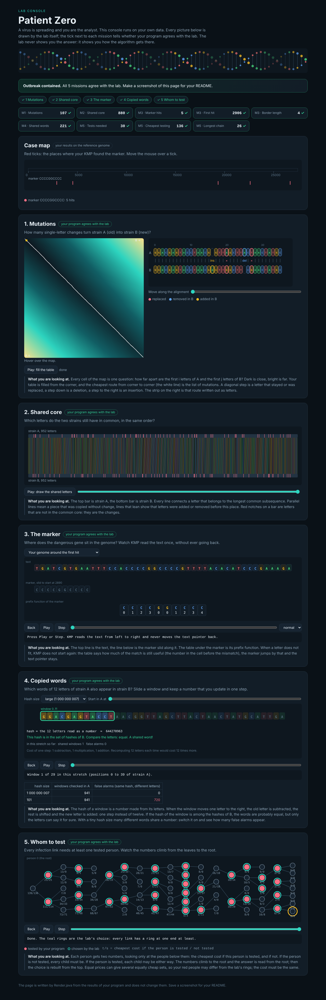

# Assignment 4. Patient Zero

Student ID: 254522
Name: Arnur Sadyrov (Арнур Садыров)
Group: SE-2532

This file is the report. Fill it in as you go. How to start: `START_HERE.md`. The task: `docs/Assignment4.pdf`.

## Program output

The 9 lines your program prints on your data (`java -cp out Main`):

    Mutations: 107
    Shared core: 880
    Marker hits: 5
    First hit: 2906
    Border length: 4
    Shared words: 221
    Tests needed: 30
    Cheapest testing: 136
    Longest chain: 26

My outbreak report (a screenshot of `output/outbreak.html`):

## Questions

Answer in your own words, two or three sentences each.

Mission 1. What does the cell d[i][j] of your table mean, and how is it computed from other cells?

d[i][j] is the smallest number of changes (replace, insert, delete) that turn the first i letters of A into the first j letters of B. The first row is d[0][j] = j (insert j letters) and the first column is d[i][0] = i (delete i letters). Every other cell is the minimum of three smaller cells: d[i-1][j-1] (+0 if A[i-1] = B[j-1], else +1 for a replacement), d[i-1][j] + 1 (delete a letter of A) and d[i][j-1] + 1 (insert a letter of B). The answer is d[n][m].

Mission 2. How is the longest common subsequence different from the longest common substring? My Shared core is bigger than the number of letters that are the same at the same place: why?

A substring must be a block of neighbouring letters, a subsequence may skip letters, it only keeps the order. The Shared core is bigger than the letters equal at the same position because insertions and deletions shift one strain against the other: letters that match after a shift are not at the same index, but they still keep their order, so the LCS counts them.

Mission 3. What does the prefix function tell you, and why does the pointer in the text never go back in KMP? What is the Border length of my marker and what does it mean?

pi[i] is the length of the longest proper prefix of the marker p[0..i] that is also its suffix (its longest border). On a mismatch after k matched letters, the last k letters of the text are equal to p[0..k-1], so the longest part that can still match is the border pi[k-1]. KMP moves only the marker pointer back to pi[k-1] and keeps the text pointer where it is, so every text letter is read once and the pointer never goes back. My Border length is 4. The marker is CCCCGGCCCC (length 10). Its first 4 letters (CCCC) are the same as its last 4 letters, so a copy of the marker can start before the previous copy has ended: two hits can overlap by 4 letters. After a full match KMP does not restart from 0, it falls back to pi[m-1] = 4 and goes on, so overlapping hits are counted too.

Mission 4. Why must you compare the letters after the hashes are equal? What happens to the cost of Rabin-Karp if many windows have the same hash?

Different words can have the same hash (a collision, because there are more words than hash values), so equal hashes only say "maybe equal". Without the comparison the count would be wrong and would change with MOD. If many windows have the same hash, every such window needs a letter-by-letter comparison of k letters, so the cost grows from about O(n) to O(n*k) or worse (with a huge number of equal hashes, every window is compared with many windows of B).

Mission 5. What are the two states of a person in your DP, and how do you get the answer for a person from its children? Why does a greedy "test the person with most links first" not always give the cheapest answer?

For every person v (with its subtree): in[v] = the cheapest cost when v is tested, out[v] = the cheapest cost when v is not tested. in[v] = cost[v] + sum over children of min(in[c], out[c]); out[v] = sum over children of in[c], because if v is not tested every child must be tested to cover the link. The answer is min(in[0], out[0]) and I rebuild who is tested walking down from the root. A greedy choice looks at one person only and ignores costs and what the choice does to the neighbours: the person with most links may be very expensive while testing two cheap neighbours covers the same links for less, so only the DP over the whole tree is correct.

## AI use

I used Claude (Anthropic's AI assistant). Claude wrote the code of Missions 1 to 5 (`Strains.java`, `Marker.java`, `Outbreak.java`), generated the data files with `tools/MakeVariant.java` from my ID, ran the program, made the screenshot, ran the benchmark, wrote the draft of the answers and of the complexity table in this README, and made the git commits. I did not write this code myself. No code or text from books or websites was used.

## Timing (Mission 7)

Milliseconds, average of 3 runs, from `java -cp out Bench`.

| test | size | time |
|---|---|---|
| naive search | 20 000 / 40 000 / 80 000 | 31.3 / 30.0 / 62.1 ms |
| KMP | 20 000 / 40 000 / 80 000 | 1.4 / 1.5 / 0.5 ms |
| edit distance | 500 / 1000 / 2000 / 4000 | 6.0 / 8.7 / 25.5 / 151.9 ms |

What do the numbers say about how the time grows? When you double the size, by how much does each time grow? Two or three sentences.

The naive search needs about n*m steps on this text, so its time grows roughly in proportion to the text (about 2x when the text doubles; the small sizes are noisy), while KMP stays around 1 ms because it reads every letter once, O(n + m). The edit distance table has n*m cells, so doubling the length makes it about 4 times slower (25.5 ms to 151.9 ms for 2000 to 4000, a bit more than 4x because the 64 MB table does not fit in the cache; the small sizes are dominated by the start-up of the JVM).

## Complexity

n is the length of the text (or of a strain), m the length of the pattern, k the length of the window, v the number of people. Fill in every algorithm you wrote.

| algorithm | time | space | assumptions |
|---|---|---|---|
| Edit distance | O(n*m) | O(n*m) | n, m are the lengths of A and B; one cell is O(1); the whole table is stored (two rows would give O(min(n, m)) memory, but then the route cannot be rebuilt) |
| LCS | O(n*m) | O(n*m) | same table size as the edit distance; each cell takes the diagonal or the maximum of two neighbours |
| Prefix function and KMP | O(m) for the prefix function, O(n + m) for the search | O(m) for pi (+ O(n) for the hits array in the worst case) | n = text length, m = marker length; the text pointer never goes back and the marker pointer moves back at most as many times as it moved forward (amortized) |
| Rabin-Karp (shared words) | expected O(n + m + hits*k); worst case O(n*m*k) | O(m) for the map of the windows of B | n, m = lengths of A and B, k = window length (12); the hash of the next window is O(1); the worst case is when almost all hashes are equal and every window is compared with many windows |
| Tree DP | O(v) | O(v) | v = number of people; every person and link is visited once in the DFS; the recursion depth is at most v |

## Before you submit

- The four files in `data` and the screenshot `output/outbreak.png` are in the repository.
- `java tools/Check.java` shows all examples right.
- This README is filled in, the program output and the section AI use included.
- The work is pushed to main (at least one commit per mission) and the repository is public.
- The link is attached in Moodle.
